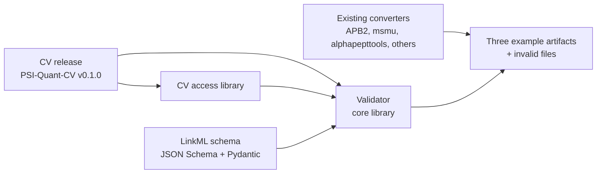

# Roadmap: a PSI Recommendation for quantitative proteomics in AnnData

**Status:** Draft for team review, 2026-11-18
**Owner:** Lisa Boatner (Chan Zuckerberg Initiative), HUPO-PSI AI Readiness Working Group, PSI-AI Quant Subgroup
**Audience:** subgroup members and collaborators who will take tasks
**Companion:** three parent issues in this repository, one per track, hold the task lists. This document is the direction; the issues are the assignments.

## Why this document

The PSI-AI Quant Subgroup is producing a PSI specification in the style of mzPeak, with
reference implementations and a core library. A schema already exists. This roadmap sets out the full
deliverable around it in one place, so that everyone working on it shares the same picture
of what the finished product is, which pieces it has, who holds which piece, and when it is
done.

It states what we are building, why it matters, how the work splits into three tracks, what
is decided and what is still open, and the milestones to the EuBIC-MS hackathon in January
2027 and the PSI Document Process beyond it.

## What we are building

A HUPO-PSI **Recommendation** that defines how quantitative proteomics results are
represented in AnnData and MuData containers, together with the artifacts the PSI Document
Process requires before it ratifies a data format.

The PSI Document Process (v1.1.2) recognises four document types: Community Practice,
Informational, MIAPE, and Recommendation. A data format is a Recommendation. For a
Recommendation that describes a data format, the process asks for the schema, three instance
files produced in different laboratories, and a reference implementation. That requirement
list is what defines our deliverables.

| Component | What it is | Why it is needed | Where it lives | Status, Nov 2026 |
|---|---|---|---|---|
| Specification document | Prose specification: introduction, data model, schema reference, conformance, profiles. Published as a site, exported to DOCX and PDF for submission. | The document PSI reviews and ratifies. | this repository, `docs/` | The schema body exists as MIAPE-AnnData 0.5.0 (`schemas/`). The prose chapters are not started. |
| Structural schema | LinkML model, with generated JSON Schema and Pydantic classes. | Machine-readable definition. Generates the validator's structured checks and, later, the specification's field tables. | this repository, `schema/` | Not started. |
| Quantification CV release | A tagged OWL release of the Quantification controlled vocabulary. | Gives provenance terms their scientific meaning. The validator pins a release. | `HUPO-PSI/PSI-Quant-CV` | Live in WebProtégé. No release yet. |
| CV access library | Python package that loads a release, looks up terms, tests ancestry. | The validator's semantic checks and any downstream tool. | to be decided | In progress. |
| Validator and core library | Library and CLI that read, write and validate artifacts. | The only way to demonstrate conformance. | to be decided | Not started. |
| Converters | Existing producer tools (APB2, msmu, alphapepttools and others) that turn search-engine output into artifacts. Not built by the subgroup. | Produce the instance files and show the specification can be implemented from the text alone. | the producers' repositories, linked from the Implementations page | Exist. Remaining: run their output through the validator and list them on the Implementations page. |
| Example artifacts | Three instance files from different laboratories and practices, plus one invalid file per validator rule. | The three instance documents PSI asks for. The validator's test corpus. | this repository, `examples/` | Not started. |

The first two rows are the specification itself. The remaining five are what makes it
testable and ratifiable. "Core library" in PSI usage means the read, write and validate
package: mzSpecLib calls its Python package the reference implementation, and mzPeak names
a reference reader and writer plus a conformance validator. The CV access library is a
dependency of that package, not the package itself.

## Why it matters

- Six current producers write proteomics AnnData objects that are mutually incompatible in
  column names, layer semantics and provenance. Nothing produced by one can be compared with,
  or validated against, another. There is no deposition target for the analysis-ready object.
- Processing provenance, meaning which normalisation, imputation, inference and filtering
  steps produced a matrix, is recorded as free text or not at all. Datasets cannot be
  selected or reprocessed by what was done to them, which is the AI-readiness gap this
  working group exists to close.
- The EuBIC-MS hackathon at the end of January 2027 will harden the schema, build the
  validator, and validate the output of existing converters against this specification. It
  needs a frozen draft, not a finished standard.
- The existing MIAPE-AnnData schema is not thrown away. It is the normative core of the
  Recommendation, the chapter that defines every slot and column. The Recommendation wraps it
  with the chapters a reader needs to understand it and the artifacts PSI needs to ratify it.

## How we will do it: three tracks

Each track has one parent issue with a checklist of child issues. Take a child issue, not a
track.

### Document track

Goal: a complete Draft a reviewer outside the subgroup can read end to end.

The site follows the mzPeak specification's layout, which is small: its introductory pages
are a few hundred words each. The bulk of a format specification is the schema reference,
and ours already exists.

Sequence: scaffold the site with the PSI front matter and intellectual-property statement;
write the Introduction (overview and motivation, related specifications, notational
conventions); write the Data Model chapter in prose with one diagram; split the schema into
reference pages without changing a word; write the Conformance chapter (conformant artifact,
producer and consumer; validation levels; core and profiles); fold in and retire the May 2026
module-specification document; add Foundations, Profiles, Implementations and the Reference
pages; add the DOCX and PDF export.

Rule: prose chapters are informative, schema-reference tables are normative. A change to a
table is a schema change with its own decision record.

### Artifacts track

Goal: the machine-readable and executable half.

Sequence and dependencies:

The CV release is the gate for everything semantic. Until it exists the validator can check
structure and matrices but not whether a provenance term means what it claims. The LinkML
schema is the gate for everything generated. Converters are not built in this track: existing
producer tools convert, and the validator judges their output. The validator is therefore the
build that matters most here, and it stays independent of every converter so that compliance
is a property of the object, not of the tool that wrote it.

The validator has three layers: checks generated from the LinkML schema; hand-written checks
for what a JSON Schema cannot see, such as matrix dtype, layer shape, index identity and
cross-modality foreign keys; and semantic checks driven by a machine-readable rules file in
the shape mzPeak uses, resolved through the CV access library against a pinned release.

### Process track

Goal: the decisions that belong to the working group are made and recorded, the PSI editor
has been consulted, and a submission package exists.

Sequence: confirm the document type and name with the subgroup; contact the PSI editor on
suitability and timing, which the process document recommends before formatting effort;
make the open decisions listed below; recruit three laboratories for the instance files;
freeze; assemble the submission package.

## Milestones

Dates are targets. The freeze is fixed by the hackathon; everything after it is paced by the
PSI process.

| When | Milestone | Evidence |
|---|---|---|
| November 2026 | Plan agreed. Site scaffolded. CV release `v0.1.0` tagged. | Parent issues filed and assigned. `mkdocs build` passes. Tag exists. |
| Early December 2026 | **Draft 1 freeze:** specification, LinkML schema and CV release pinned together. Editing stops. | Tags on this repository and PSI-Quant-CV. |
| December 2026 to January 2027 | Validator alpha. Three example artifacts. Existing converters run against the validator. | Validator passes the examples and fails each invalid file. |
| End of January 2027 | EuBIC-MS hackathon hardens the schema and validator against Draft 1. | Output of at least two existing converters passes the validator. A triaged list of specification gaps. |
| February to March 2027 | Draft 2 with hackathon feedback. Submission package assembled. | DOCX and PDF, examples, implementation, IP statement, cover letter. |
| Spring 2027 | Submitted to the PSI editor. Steering Group review, up to 14 days. 45-day public comment with invited reviewers. | Editor's acknowledgement. Review comments on file. |
| Later 2027 | Final, or a revision round. | PSI publication. |

## Roles

| Role | Who | Owns |
|---|---|---|
| Specification editor | Lisa Boatner | Document and Process tracks; overall coherence. |
| Quantification CV and CV access library | PSI-AI Quant Subgroup | The vocabulary release and the Python package the validator calls; its contract with the validator. |
| Engine-side review | TBD | Feasibility of each MUST and SHOULD per engine; review of the Conformance chapter. |
| Producers | msmu (BERTIS), apb2 (FGCZ), alphapepttools, proteopy maintainers | Example artifacts; implementation feedback; candidates for the Implementations page. |
| Validator | TBD | The validator and core library; the Artifacts track's open build. |
| Converters | producer maintainers (APB2, msmu, alphapepttools, others) | Keep their exporters current with the specification. The subgroup validates their output and lists them on the Implementations page. |
| PSI editor | current PSI editors | Suitability, timing, the Document Process. |

## Decisions

### Decided

- The schema reference tables are normative; prose chapters are informative.
- The controlled vocabulary stays in OWL, authored in WebProtégé and released from
  PSI-Quant-CV. LinkML models the structure of the artifact, not the ontology.
- Provenance term accessions are constrained by pattern plus lookup against a pinned CV
  release, not by an enumerated list, so new terms need a CV release and not a schema
  release.
- No in-house converter. Existing producer tools convert search-engine output. The subgroup
  builds and owns the schema and the validator, which stay independent of every converter.
  Compliance is a property of the object, checked by the validator, not inferred from which
  tool produced it. (Merged EuBIC-MS 2027 proposal, October 2026.)
- Freeze before the hackathon; ratification after it.

### Open, with owner and deadline

| Decision | Options | Owner | By |
|---|---|---|---|
| Document type and name | Recommendation (proposed) or MIAPE; keep "MIAPE-AnnData" as the title, rename, or keep it as the name of the core conformance class | subgroup | before the site scaffold is public |
| Sample metadata columns in `obs` | Keep the SDRF-derived columns in the specification, or define the structural columns and delegate sample vocabulary to SDRF-Proteomics through the mapping rule | subgroup | before Draft 1 freeze |
| Core versus profiles | Which modalities and designs are core; which are profiles | subgroup | with the Conformance chapter |
| CV accession scheme | Prefix and IRI pattern; fixed by the first tag | subgroup with CV maintainers | before `v0.1.0` |
| Specification license | CC-BY 4.0 (mzQC) or CC-BY-ND 4.0 (mzPeak) | editor with PSI editor | before the site is public |
| Authors and editors | Six or fewer, with contributors listed separately | editor | before Draft 1 freeze |
| Three laboratories | Who provides the instance files, and which practices they cover | editor | by the hackathon |
| Code repository | Validator in this repository or in a sibling | subgroup | before validator work starts |

## How work is tracked

- This roadmap states direction. It changes only when the direction changes.
- Three parent issues, one per track, each hold a checklist of child issues. Child issues are
  the unit of assignment and change weekly.
- A decision that is the working group's is recorded in a decision log when made and linked
  from the specification's home page.

## Definition of done

**Draft 1, December 2026.** The site builds with all chapters present. The LinkML schema
generates without error. The CV release is tagged and pinned. The validator checks every
MUST that can be checked mechanically. At least one example artifact passes.

**Submission, 2027.** Editable document plus PDF. Three example artifacts from different
laboratories. A validator an independent party can run, and the output of at least one
existing converter that passes it. The
intellectual-property statement and the PSI front matter complete. A cover letter to the PSI
editor.
